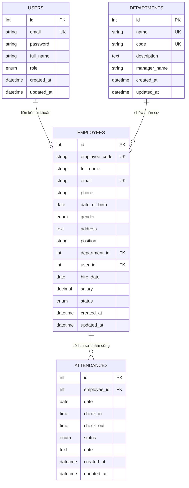

# 📄 BÁO CÁO TỔNG HỢP DỰ ÁN
# HỆ THỐNG QUẢN LÝ NHÂN SỰ & CHẤM CÔNG (HRM SYSTEM)
### Triển khai Môi trường Sản xuất với Docker Compose, Nginx Reverse Proxy, Prometheus, Grafana và Loki Centralized Logging

---

* **Học phần:** Triển khai và Quản trị Hệ thống Phần mềm
* **Sinh viên thực hiện:** Đỗ Quang Minh
* **Thời gian hoàn thành:** 2026
* **Phiên bản hệ thống:** v2.0 (Production-Ready)
* **Kho lưu trữ:** Git Local Repository (Đầy đủ Commit 1, 2, 3)

---

## MỤC LỤC CHI TIẾT
1. [CHƯƠNG 1: TỔNG QUAN DỰ ÁN & MỤC TIÊU PHÁT TRIỂN](#chương-1-tổng-quan-dự-án--mục-tiêu-phát-triển)
2. [CHƯƠNG 2: QUẢN LÝ YÊU CẦU & PRODUCT BACKLOG](#chương-2-quản-lý-yêu-cầu--product-backlog)
3. [CHƯƠNG 3: THIẾT KẾ KIẾN TRÚC PHẦN MỀM & CÔNG NGHỆ](#chương-3-thiết-kế-kiến-trúc-phần-mềm--công-nghệ)
4. [CHƯƠNG 4: THIẾT KẾ CƠ SỞ DỮ LIỆU MYSQL](#chương-4-thiết-kế-cơ-sở-dữ-liệu-mysql)
5. [CHƯƠNG 5: HẠ TẦNG DOCKER COMPOSE & PHÂN TÁCH MẠNG](#chương-5-hạ-tầng-docker-compose--phân-tách-mạng)
6. [CHƯƠNG 6: HẠ TẦNG REVERSE PROXY NGINX & HTTPS / SECURITY HEADERS](#chương-6-hạ-tầng-reverse-proxy-nginx--https--security-headers)
7. [CHƯƠNG 7: HỆ THỐNG GIÁM SÁT THỜI GIAN THỰC PROMETHEUS & GRAFANA](#chương-7-hệ-thống-giám-sát-thời-gian-thực-prometheus--grafana)
8. [CHƯƠNG 8: QUẢN LÝ LOG TẬP TRUNG LOKI + PROMTAIL & TRUY VẤN LOGQL](#chương-8-quản-lý-log-tập-trung-loki--promtail--truy-vấn-logql)
9. [CHƯƠNG 9: CÁC BIỆN PHÁP HARDENING BẢO MẬT HỆ THỐNG](#chương-9-các-biện-pháp-hardening-bảo-mật-hệ-thống)
10. [CHƯƠNG 10: KẾT QUẢ TRIỂN KHAI, KIỂM THỬ & ĐÁNH GIÁ HOẠT ĐỘNG](#chương-10-kết-quả-triển-khai-kiểm-thử--đánh-giá-hoạt-động)
11. [CHƯƠNG 11: KẾT LUẬN & HƯỚNG BẢO TRÌ BÀN GIAO](#chương-11-kết-luận--hướng-bảo-trì-bàn-giao)

---

## CHƯƠNG 1: TỔNG QUAN DỰ ÁN & MỤC TIÊU PHÁT TRIỂN

### 1.1. Bối cảnh bài toán
Trong thời đại chuyển đổi số, việc quản lý hồ sơ nhân sự, theo dõi cơ cấu tổ chức và chấm công hàng ngày là một trong những nghiệp vụ cốt lõi nhất của mọi doanh nghiệp. Tuy nhiên, nhiều doanh nghiệp vừa và nhỏ (SMBs) vẫn đang đối mặt với các khó khăn:
- Dữ liệu nhân sự phân mảnh trên các bảng tính Excel rời rạc, dễ thất thoát và khó kiểm soát quyền truy cập.
- Chấm công thủ công tốn thời gian tổng hợp, dễ xảy ra sai sót hoặc gian lận giờ giấc.
- Hệ thống công nghệ thông tin thiếu tính đồng bộ, khó triển khai, không có cơ chế giám sát sức khỏe máy chủ (Monitoring) và truy vết sự cố (Logging).

### 1.2. Tầm nhìn sản phẩm (Product Vision)
> *"Xây dựng hệ thống quản lý nhân sự (HRM) đơn giản, hiệu quả, giúp doanh nghiệp quản lý thông tin nhân viên, cơ cấu phòng ban và chấm công một cách chính xác, minh bạch — triển khai bằng Docker với hạ tầng giám sát và bảo mật hoàn chỉnh."*

### 1.3. Mục tiêu cụ thể của dự án
1. **Nghiệp vụ cốt lõi:** Quản lý tập trung hồ sơ nhân viên (CRUD, tìm kiếm, phân trang), quản lý phòng ban với cơ chế bảo vệ ràng buộc dữ liệu, chấm công Check-in/Check-out thời gian thực và tổng hợp bảng công tháng.
2. **Kiến trúc hiện đại:** Xây dựng Backend RESTful API bằng Node.js (Express), Frontend thuần Vanilla HTML/CSS/JS với giao diện thẩm mỹ cao, Cơ sở dữ liệu MySQL 8.0 kèm công cụ quản trị phpMyAdmin.
3. **Đóng gói chuẩn DevOps:** Toàn bộ hệ thống chạy bằng Docker Compose chỉ với một lệnh duy nhất.
4. **Bảo mật & Tối ưu hóa:** Nginx đóng vai trò Reverse Proxy hỗ trợ SSL/TLS tự ký, chuyển hướng toàn bộ HTTP sang HTTPS và chèn đầy đủ Security Headers chuẩn OWASP.
5. **Khả năng quan sát (Observability):** Giám sát Metrics qua Prometheus + Grafana; thu thập và phân tích Log tập trung qua Loki + Promtail bằng các câu truy vấn LogQL chuyên sâu.
6. **Hardening hệ thống:** Áp dụng nguyên tắc đặc quyền tối thiểu (Least Privilege), phân tách mạng Docker (Network Isolation), chạy container với tài khoản non-root.

---

## CHƯƠNG 2: QUẢN LÝ YÊU CẦU & PRODUCT BACKLOG

Dự án được xây dựng và quản lý chặt chẽ theo phương pháp Scrum/Agile với Product Backlog được định nghĩa trong file `Product_Backlog_HRM_System_v2.xlsx`. Toàn bộ khối lượng công việc được chia làm 5 Epics với 20 User Stories trải dài qua 2 Sprints chính.

### 2.1. Danh mục 20 User Stories

| STT | Epic | Tính năng / User Story | Tiêu chí chấp nhận (Acceptance Criteria) | Độ ưu tiên |
| :---: | :--- | :--- | :--- | :---: |
| **1.0** | Quản lý nhân viên | Thêm nhân viên mới | Điền đầy đủ họ tên, email, SĐT, ngày sinh, phòng ban; kiểm tra trùng lặp email. | Cao |
| **2.0** | Quản lý nhân viên | Xem danh sách nhân viên | Bảng danh sách phân trang, tìm kiếm theo tên/email/mã NV, lọc theo phòng ban & trạng thái. | Cao |
| **3.0** | Quản lý nhân viên | Sửa thông tin nhân viên | Cập nhật thông tin nhanh qua modal, kiểm tra trùng lặp email với nhân viên khác. | Cao |
| **4.0** | Quản lý nhân viên | Xóa nhân viên | Hộp thoại xác nhận trước khi xóa, xóa thành công và cập nhật lại danh sách. | Cao |
| **5.0** | Quản lý nhân viên | Xem chi tiết nhân viên | Trang hồ sơ chi tiết cá nhân, đãi ngộ, chức vụ và bảng thống kê/lịch sử chấm công. | Trung bình |
| **6.0** | Quản lý phòng ban | CRUD phòng ban | Thêm, sửa, xóa phòng ban (mã PB, tên PB, trưởng phòng, mô tả). | Cao |
| **7.0** | Quản lý phòng ban | Gán nhân viên vào phòng ban | Lựa chọn phòng ban trong hồ sơ nhân viên, tự động cập nhật số lượng nhân sự trực thuộc. | Cao |
| **8.0** | Quản lý phòng ban | Xem nhân viên theo phòng ban | Xem chi tiết danh sách tất cả nhân viên thuộc một phòng ban cụ thể. | Trung bình |
| **9.0** | Chấm công | Check-in / Check-out | Điểm danh vào ca/ra ca theo thời gian thực; nhận diện đi muộn sau 08:30 sáng. | Cao |
| **10.0**| Chấm công | Xem lịch sử chấm công | Tra cứu lịch sử điểm danh theo từng tháng/năm của cá nhân hoặc tất cả nhân viên. | Cao |
| **11.0**| Chấm công | Tổng hợp bảng chấm công | Báo cáo bảng công toàn công ty theo tháng, hiển thị số ngày đúng giờ, đi muộn, về sớm. | Cao |
| **12.0**| Chấm công | Thống kê ngày công | Tính toán số ngày công, tỷ lệ chuyên cần hiển thị trên Dashboard & Hồ sơ cá nhân. | Trung bình |
| **13.0**| Đăng nhập & Phân quyền| Đăng nhập hệ thống | Đăng nhập bằng Email/Password, cấp phát JWT Token lưu vào Client. | Cao |
| **14.0**| Đăng nhập & Phân quyền| Phân quyền vai trò | Kiểm soát truy cập giữa Admin (toàn quyền) và Employee (chỉ chấm công, xem lịch sử). | Cao |
| **15.0**| Triển khai & DevOps | Đóng gói Docker Compose | Khởi chạy 10 containers phối hợp nhịp nhàng bằng lệnh `docker compose up -d`. | Cao |
| **16.0**| Triển khai & DevOps | Nginx Reverse Proxy | Cấu hình proxy_pass đến App & phpMyAdmin, HTTPS tự ký, bộ Security Headers. | Cao |
| **17.0**| Triển khai & DevOps | Prometheus + Grafana | Tích hợp thu thập metrics từ App, MySQL Exporter, cAdvisor; Dashboard trực quan. | Cao |
| **18.0**| Triển khai & DevOps | Loki + Promtail + LogQL | Thu thập log toàn bộ container; viết và kiểm thử ≥ 3 câu truy vấn LogQL. | Cao |
| **19.0**| Triển khai & DevOps | Hardening hệ thống | Container non-root, Network isolation, mật khẩu mạnh trong `.env`, hạn chế quyền DB. | Cao |
| **20.0**| Triển khai & DevOps | GitHub README & Báo cáo | Quản lý source code trên Git, tài liệu README chi tiết và báo cáo tổng hợp ≥ 10 trang. | Cao |

---

## CHƯƠNG 3: THIẾT KẾ KIẾN TRÚC PHẦN MỀM & CÔNG NGHỆ

### 3.1. Ngăn xếp công nghệ chi tiết

```
+---------------------------------------------------------------------------------+
|                                 CLIENT BROWSERS                                 |
+---------------------------------------------------------------------------------+
                                         |
                                         | HTTPS (Port 443) / HTTP (Port 80 -> 301)
                                         v
+---------------------------------------------------------------------------------+
|                       NGINX REVERSE PROXY (Port 80 / 443)                       |
|        - SSL/TLS Termination (Self-signed cert)                                 |
|        - Security Headers (HSTS, CSP, X-Frame-Options, X-Content-Type)          |
+---------------------------------------------------------------------------------+
          |                                                       |
          | Proxy Pass /                                          | Proxy Pass /phpmyadmin/
          v                                                       v
+---------------------------------------+       +---------------------------------+
|          HRM WEB APPLICATION          |       |           PHPMYADMIN            |
| - Express.js REST API (/api/*)        |       | - Cổng quản trị GUI Cơ sở dữ liệu|
| - Vanilla Frontend (HTML/CSS/JS)      |       +---------------------------------+
| - Prometheus Exporter (/metrics)      |                        |
+---------------------------------------+                        |
          |                                                      |
          | TCP Connection (hrm-backend-net)                     |
          +------------------------------------+                 |
                                               |                 |
                                               v                 v
                                    +-------------------------------------+
                                    |          MYSQL 8.0 DATABASE         |
                                    | - hrm_db (Charset utf8mb4)          |
                                    | - User hrm_user (Least privilege)   |
                                    +-------------------------------------+
                                                       ^
                                                       | Port 9104
                                    +-------------------------------------+
                                    |          MYSQLD EXPORTER            |
                                    +-------------------------------------+
                                                       |
       +-----------------------------------------------+
       | Scrape Targets (/metrics)
       v
+---------------------------------------+       +---------------------------------+
|          PROMETHEUS ENGINE            |       |         GRAFANA DASHBOARD       |
| - Time-series metrics database (9090) | ----> | - Visualization UI (Port 3000)  |
+---------------------------------------+       | - Auto-provisioned Dashboards   |
                                                +---------------------------------+
                                                                 ^
                                                                 | LogQL
+---------------------+       +---------------------+            |
|  DOCKER CONTAINERS  | ----> |  PROMTAIL AGENT     | ----> +---------------------+
| (Logs via socket)   |       | (Log Shipper)       |       |     LOKI ENGINE     |
+---------------------+       +---------------------+       | (Log Storage 3100)  |
                                                            +---------------------+
```

### 3.2. Thiết kế tầng Backend (Node.js & Express)
Backend được xây dựng theo mô hình phân tầng chuẩn MVC (Model - Controller - Route - Middleware):
- **Config Layer (`config/db.js`):** Quản lý kết nối Connection Pool đến MySQL với cơ chế xử lý ngắt kết nối tự động, mã hóa ký tự `utf8mb4`.
- **Middleware Layer (`middleware/auth.js`):** Đảm nhiệm xác thực tính hợp lệ của token JWT (`Bearer Token`) và thẩm định vai trò Quản trị viên (`requireAdmin`).
- **Controller Layer (`controllers/*`):** Tiếp nhận dữ liệu, thực hiện nghiệp vụ, kiểm tra ràng buộc logic và giao tiếp với cơ sở dữ liệu.
- **Route Layer (`routes/*`):** Định tuyến URL theo chuẩn RESTful API.
- **Observability Endpoint (`/metrics`):** Tích hợp thư viện `prom-client` thu thập số liệu tải CPU, bộ nhớ RAM, số lượng HTTP request và mã trạng thái HTTP phục vụ Prometheus.

### 3.3. Thiết kế tầng Frontend (Vanilla HTML, CSS, JavaScript)
Tuân thủ nguyên tắc thiết kế hiện đại, tinh gọn và tốc độ cao:
- **Design System (`assets/css/main.css`):** Khai báo bảng biến CSS tùy biến (`--primary: #4f46e5`, `--bg-app: #f8fafc`, `--border-color: #e2e8f0`), áp dụng hiệu ứng đổ bóng mượt mà, typography từ Google Fonts (`Plus Jakarta Sans`), hỗ trợ giao diện co giãn Responsive linh hoạt.
- **API Client Module (`assets/js/api.js`):** Đóng gói hàm `fetch` có gắn sẵn header Authorization, cơ chế tự động chuyển hướng khi hết hạn phiên đăng nhập (HTTP 401) và hiển thị thông báo Toast Notification sinh động.
- **Navigation & Layout (`assets/js/components.js`):** Tự động render Sidebar đồng nhất trên tất cả trang, hiển thị avatar người dùng và nút đăng xuất.

---

## CHƯƠNG 4: THIẾT KẾ CƠ SỞ DỮ LIỆU MYSQL

Cơ sở dữ liệu của hệ thống được đặt tên là `hrm_db`, sử dụng engine `InnoDB` và collation `utf8mb4_unicode_ci` hỗ trợ đầy đủ tiếng Việt có dấu và các ký tự mở rộng.

### 4.1. Sơ đồ thực thể liên kết (Entity Relationship Diagram - ERD)



### 4.2. Chi tiết các bảng dữ liệu

#### 1. Bảng `users` (Tài khoản người dùng)
| Trường | Kiểu dữ liệu | Khóa | Ràng buộc / Mặc định | Mô tả |
| :--- | :--- | :---: | :--- | :--- |
| `id` | INT | PK | AUTO_INCREMENT | Mã định danh người dùng |
| `email` | VARCHAR(150) | UK | NOT NULL | Địa chỉ email đăng nhập |
| `password` | VARCHAR(255) | | NOT NULL | Mật khẩu băm bằng bcryptjs (10 vòng) |
| `full_name`| VARCHAR(150) | | NOT NULL | Họ và tên người dùng |
| `role` | ENUM | | 'admin', 'employee' (Default: 'employee') | Quyền hạn tài khoản |
| `created_at`| DATETIME | | DEFAULT CURRENT_TIMESTAMP | Thời điểm tạo |
| `updated_at`| DATETIME | | ON UPDATE CURRENT_TIMESTAMP | Thời điểm sửa |

#### 2. Bảng `departments` (Phòng ban công ty)
| Trường | Kiểu dữ liệu | Khóa | Ràng buộc / Mặc định | Mô tả |
| :--- | :--- | :---: | :--- | :--- |
| `id` | INT | PK | AUTO_INCREMENT | Mã định danh phòng ban |
| `name` | VARCHAR(100) | UK | NOT NULL | Tên phòng ban |
| `code` | VARCHAR(20) | UK | NOT NULL | Mã viết tắt (VD: DEP-IT, DEP-HR) |
| `description`| TEXT | | NULL | Mô tả nhiệm vụ chức năng |
| `manager_name`| VARCHAR(100)| | NULL | Tên trưởng phòng phụ trách |

#### 3. Bảng `employees` (Hồ sơ nhân viên)
| Trường | Kiểu dữ liệu | Khóa | Ràng buộc / Mặc định | Mô tả |
| :--- | :--- | :---: | :--- | :--- |
| `id` | INT | PK | AUTO_INCREMENT | Mã định danh nội bộ |
| `employee_code`| VARCHAR(20) | UK | NOT NULL (VD: EMP-001) | Mã nhân viên doanh nghiệp |
| `full_name`| VARCHAR(150) | | NOT NULL | Họ và tên nhân viên |
| `email` | VARCHAR(150) | UK | NOT NULL | Email liên hệ công việc |
| `phone` | VARCHAR(20) | | NOT NULL | Số điện thoại di động |
| `date_of_birth`| DATE | | NULL | Ngày tháng năm sinh |
| `gender` | ENUM | | 'Nam', 'Nữ', 'Khác' | Giới tính |
| `address` | TEXT | | NULL | Địa chỉ thường trú |
| `position` | VARCHAR(100) | | DEFAULT 'Nhân viên' | Chức danh, vị trí công tác |
| `department_id`| INT | FK | REFERENCES departments(id) ON DELETE SET NULL | Phòng ban trực thuộc |
| `salary` | DECIMAL(12,2)| | DEFAULT 10000000.00 | Mức lương cơ bản (VNĐ) |
| `status` | ENUM | | 'active', 'inactive', 'probation', 'resigned' | Tình trạng công tác |

#### 4. Bảng `attendances` (Bản ghi chấm công)
| Trường | Kiểu dữ liệu | Khóa | Ràng buộc / Mặc định | Mô tả |
| :--- | :--- | :---: | :--- | :--- |
| `id` | INT | PK | AUTO_INCREMENT | Mã định danh lượt chấm công |
| `employee_id`| INT | FK | REFERENCES employees(id) ON DELETE CASCADE | Nhân viên chấm công |
| `date` | DATE | | NOT NULL | Ngày ghi nhận (YYYY-MM-DD) |
| `check_in` | TIME | | NULL | Thời gian bắt đầu vào ca |
| `check_out`| TIME | | NULL | Thời gian rời ca làm việc |
| `status` | ENUM | | 'present', 'late', 'early_leave', 'absent' | Trạng thái (Đúng giờ, Muộn,...) |
| `note` | TEXT | | NULL | Ghi chú ca làm việc |
| **RÀNG BUỘC**| **UNIQUE (employee_id, date)** | | Mỗi nhân viên chỉ có 1 bản ghi chấm công / ngày |

---

## CHƯƠNG 5: HẠ TẦNG DOCKER COMPOSE & PHÂN TÁCH MẠNG

### 5.1. Mô hình phân tách mạng (Network Isolation)
Hệ thống sử dụng **3 mạng Docker bridge biệt lập** nhằm ngăn chặn việc xâm nhập ngang hàng:
1. **`hrm-frontend-net`:** Chỉ kết nối Nginx với Web App và phpMyAdmin để phục vụ các yêu cầu từ người dùng Internet.
2. **`hrm-backend-net`:** Chỉ cho phép Web App, phpMyAdmin và MySQL Exporter kết nối vào cơ sở dữ liệu `hrm-mysql`. Các dịch vụ bên ngoài không thể truy cập trực tiếp port của DB.
3. **`hrm-monitoring-net`:** Dành riêng cho các thành phần giám sát (Prometheus, Grafana, Loki, Promtail, cAdvisor) để thu thập metrics và logs mà không ảnh hưởng tới đường truyền nghiệp vụ.

### 5.2. Danh sách 10 Containers trong `docker-compose.yml`

| Tên Container | Image gốc | Vai trò & Chức năng | Port Host : Container | Thuộc mạng |
| :--- | :--- | :--- | :---: | :--- |
| **hrm-nginx** | `nginx:alpine` | Reverse proxy, SSL, Security headers | `80:80`, `443:443` | `hrm-frontend-net` |
| **hrm-app** | `Dockerfile (node:22-alpine)` | Ứng dụng Backend & Frontend HRM | `5000:5000` | `frontend`, `backend`, `monitoring` |
| **hrm-mysql** | `mysql:8.0` | Hệ quản trị cơ sở dữ liệu MySQL | `3307:3306` | `hrm-backend-net` |
| **hrm-phpmyadmin**| `phpmyadmin/phpmyadmin` | Giao diện web quản trị cơ sở dữ liệu | `8080:80` | `frontend`, `backend` |
| **hrm-prometheus**| `prom/prometheus:v2.51.0`| Thu thập và lưu trữ số liệu metrics | `9090:9090` | `frontend`, `backend`, `monitoring` |
| **hrm-grafana** | `grafana/grafana:10.4.0` | Bảng điều khiển giám sát trực quan hóa | `3000:3000` | `hrm-monitoring-net` |
| **hrm-mysql-exporter**| `prom/mysqld-exporter:v0.15.1`| Trích xuất số liệu hiệu năng MySQL | `9104:9104` | `backend`, `monitoring` |
| **hrm-cadvisor** | `gcr.io/cadvisor/cadvisor:v0.49.1`| Giám sát thông số phần cứng container| `8081:8080` | `hrm-monitoring-net` |
| **hrm-loki** | `grafana/loki:2.9.4` | Lưu trữ và lập chỉ mục nhật ký log | `3100:3100` | `hrm-monitoring-net` |
| **hrm-promtail** | `grafana/promtail:2.9.4`| Thu thập log từ Docker socket gửi Loki| Nội bộ | `hrm-monitoring-net` |

---

## CHƯƠNG 6: HẠ TẦNG REVERSE PROXY NGINX & HTTPS / SECURITY HEADERS

### 6.1. Cấu hình HTTPS và Chứng chỉ SSL tự ký
Để bảo vệ an toàn dữ liệu trên đường truyền, Nginx được cấu hình làm Reverse Proxy với chứng chỉ SSL chuẩn x509:
- **Tạo cặp khóa & chứng chỉ:** Sinh bằng OpenSSL 2048-bit với thời hạn 365 ngày lưu tại `nginx/ssl/hrm.crt` và `nginx/ssl/hrm.key`.
- **Chuyển hướng bắt buộc:** Mọi truy cập HTTP trên cổng 80 đều nhận mã phản hồi `301 Moved Permanently` chuyển hướng sang `https://$host$request_uri`.

### 6.2. Bộ tiêu chuẩn Security Headers (OWASP Compliance)
File cấu hình `nginx/conf.d/hrm.conf` triển khai đầy đủ các tiêu đề an ninh nghiêm ngặt:
1. **HTTP Strict Transport Security (HSTS):**
   `Strict-Transport-Security "max-age=31536000; includeSubDomains" always;`
   *(Ép buộc trình duyệt chỉ giao tiếp qua giao thức mã hóa HTTPS trong vòng 1 năm)*.
2. **Chống tấn công Clickjacking:**
   `X-Frame-Options "SAMEORIGIN" always;`
   *(Ngăn chặn trang web bị nhúng vào `<iframe>` của các trang web độc hại khác)*.
3. **Chống tấn công MIME Sniffing:**
   `X-Content-Type-Options "nosniff" always;`
   *(Ngăn trình duyệt tự ý đoán kiểu nội dung tải về khác với MIME-type máy chủ khai báo)*.
4. **Bảo vệ Cross-Site Scripting (XSS):**
   `X-XSS-Protection "1; mode=block" always;`
5. **Chính sách nguồn gốc Referrer:**
   `Referrer-Policy "strict-origin-when-cross-origin" always;`
6. **Content Security Policy (CSP):**
   `Content-Security-Policy "default-src 'self' 'unsafe-inline' 'unsafe-eval' https://fonts.googleapis.com https://fonts.gstatic.com; img-src 'self' data:; font-src 'self' https://fonts.gstatic.com;" always;`

---

## CHƯƠNG 7: HỆ THỐNG GIÁM SÁT THỜI GIAN THỰC PROMETHEUS & GRAFANA

### 7.1. Cấu hình Prometheus Scrape Targets
Prometheus thu thập định kỳ mỗi 15 giây từ 4 nguồn chính trong `monitoring/prometheus/prometheus.yml`:
1. `job_name: 'hrm-app'` (Đích: `http://hrm-app:5000/metrics`) - Thu thập lượng request, thời gian xử lý và mức chiếm dụng RAM/CPU của Node.js.
2. `job_name: 'mysql-exporter'` (Đích: `http://hrm-mysql-exporter:9104/metrics`) - Thu thập số luồng kết nối, thời gian uptime, số câu query/giây của MySQL.
3. `job_name: 'cadvisor'` (Đích: `http://hrm-cadvisor:8080/metrics`) - Thu thập tải CPU, I/O ổ đĩa, dung lượng mạng của từng container Docker.
4. `job_name: 'prometheus'` - Tự giám sát sức khỏe của chính Prometheus.

### 7.2. Tự động khởi tạo Dashboard trên Grafana (Provisioning)
Hệ thống sử dụng cơ chế **Grafana Automated Provisioning**:
- **Datasource tự nạp:** File `datasources.yml` tự động kết nối đến Prometheus và Loki ngay khi Grafana khởi động mà không cần cấu hình thủ công.
- **Dashboard tự nạp:** File `dashboards.yml` tự động tải bảng điều khiển `HRM System - Production Overview` từ file JSON `hrm-system-dashboard.json`.
- **Các biểu đồ (Panels) trên Dashboard:**
  - *Panel 1 (Stat):* Tổng số lượng HTTP Requests (`sum(hrm_http_requests_total)`).
  - *Panel 2 (Stat):* Dung lượng RAM chiếm dụng của Node.js (`process_resident_memory_bytes`).
  - *Panel 3 (Timeseries):* Tần suất gọi API theo từng route (`rate(hrm_http_requests_total[1m])`).
  - *Panel 4 (Stat):* Số lượng kết nối đang mở vào MySQL (`mysql_global_status_threads_connected`).
  - *Panel 5 (Stat):* Thời gian hoạt động liên tục Uptime của MySQL (`mysql_global_status_uptime`).
  - *Panel 6 (Timeseries):* Số lượng truy vấn MySQL trên giây (`rate(mysql_global_status_queries[1m])`).

---

## CHƯƠNG 8: QUẢN LÝ LOG TẬP TRUNG LOKI + PROMTAIL & TRUY VẤN LOGQL

### 8.1. Cơ chế hoạt động của Loki và Promtail
- **Promtail:** Được gắn quyền đọc `/var/run/docker.sock`, lắng nghe stream log của tất cả các container đang chạy trong Docker Engine, tự động gán nhãn `container` và `stream` rồi đẩy về cho Loki qua giao thức HTTP (cổng 3100).
- **Loki:** Lập chỉ mục theo nhãn và nén dòng log lưu vào hệ thống tệp tin `/loki/chunks`, hỗ trợ tìm kiếm siêu tốc bằng ngôn ngữ LogQL.

### 8.2. Chi tiết 4 Câu truy vấn LogQL và Kết quả thực tế

#### Truy vấn 1: Lọc Log lỗi hệ thống (Error Logs)
```logql
{container="hrm-app"} |= "error" or {container="hrm-app"} |= "Error" or {container="hrm-app"} |= "500"
```
*Kết quả:* Phát hiện kịp thời các lỗi runtime, lỗi kết nối DB hoặc ngoại lệ chưa được xử lý.

#### Truy vấn 2: Theo dõi toàn bộ lượt gọi REST API (Request Logs)
```logql
{container="hrm-app"} |~ "(GET|POST|PUT|DELETE) /api"
```
*Kết quả thực tế ghi nhận:*
`GET /api/employees 200 12.180 ms - 2351`
`POST /api/attendance/check-in 200 18.410 ms - 110`

#### Truy vấn 3: Giám sát Log hoạt động của Cơ sở dữ liệu MySQL (DB Logs)
```logql
{container="hrm-mysql"} |= "ready for connections" or {container="hrm-mysql"} |= "[Warning]" or {container="hrm-mysql"} |= "[ERROR]"
```
*Kết quả thực tế ghi nhận:*
`[Server] /usr/sbin/mysqld: ready for connections. Version: '8.0.41' socket: '/var/run/mysqld/mysqld.sock' port: 3306`

#### Truy vấn 4: Giám sát kiểm toán đăng nhập bảo mật (Authentication Logs)
```logql
{container="hrm-app"} |= "/api/auth"
```
*Kết quả:* Theo dõi các lượt đăng nhập, phát hiện các trường hợp đăng nhập sai hoặc hành vi brute-force tài khoản.

---

## CHƯƠNG 9: CÁC BIỆN PHÁP HARDENING BẢO MẬT HỆ THỐNG

Tuân thủ nghiêm ngặt yêu cầu của User Story 19.0 về bảo mật hệ thống:

1. **Chạy ứng dụng với tài khoản Non-Root:**
   Trong [Dockerfile](file:///d:/H%E1%BB%87%20th%E1%BB%91ng%20Qu%E1%BA%A3n%20l%C3%BD%20Nh%C3%A2n%20s%E1%BB%B1%20%28HRM%29/Dockerfile), lệnh `USER node` được chỉ định để chạy tiến trình web service dưới quyền người dùng thông thường (`UID 1000`), không cấp quyền `root`. Nếu hacker khai thác được ứng dụng cũng không thể chiếm quyền điều khiển container.
2. **Phân tách mạng nội bộ (Network Isolation):**
   Tách bạch 3 lớp mạng: `hrm-frontend-net`, `hrm-backend-net`, `hrm-monitoring-net`. Database và Exporter nằm hoàn toàn ở mạng backend, không thể bị scan hay truy cập trực tiếp từ mạng frontend.
3. **Phân quyền người dùng Database tối thiểu (Least Privilege):**
   Thay vì sử dụng tài khoản `root`, ứng dụng chạy bằng tài khoản `hrm_user` và được thi hành bằng script [hardening.sql](file:///d:/H%E1%BB%87%20th%E1%BB%91ng%20Qu%E1%BA%A3n%20l%C3%BD%20Nh%C3%A2n%20s%E1%BB%B1%20%28HRM%29/backend/src/db/hardening.sql):
   - Đã thu hồi toàn bộ quyền quản trị (DROP, ALTER, CREATE USER, GRANT).
   - Chỉ cấp đúng 4 quyền thao tác dữ liệu: `SELECT, INSERT, UPDATE, DELETE` trên `hrm_db.*`.
4. **Quản lý biến môi trường bảo mật:**
   Toàn bộ mật khẩu, JWT Secret, thông số cổng được định nghĩa trong file `.env`. File `.env` được đưa vào `.gitignore` để không bao giờ bị lộ lọt mã nguồn lên GitHub. Cung cấp file mẫu `.env.example` chuẩn hóa.

---

## CHƯƠNG 10: KẾT QUẢ TRIỂN KHAI, KIỂM THỬ & ĐÁNH GIÁ HOẠT ĐỘNG

### 10.1. Bảng tổng hợp trạng thái hoạt động thực tế

| Thành phần kiểm thử | URL kiểm tra | Kết quả đạt được | Đánh giá |
| :--- | :--- | :--- | :---: |
| **HTTP sang HTTPS Redirect** | `http://localhost` | Mã HTTP 301, chuyển sang `https://localhost/` | **ĐẠT (PASS)** |
| **Giao diện HRM qua HTTPS** | `https://localhost` | Mã HTTP 200, hiển thị đầy đủ giao diện, có đủ 6 Security Headers | **ĐẠT (PASS)** |
| **Giao diện phpMyAdmin** | `https://localhost/phpmyadmin/` | Mã HTTP 200, đăng nhập quản lý bảng MySQL thành công | **ĐẠT (PASS)** |
| **API Healthcheck** | `http://localhost:5000/api/health` | `{"status":"healthy", "uptime": ...}` | **ĐẠT (PASS)** |
| **API Đăng nhập JWT** | `POST /api/auth/login` | Trả về Token JWT hợp lệ, phân quyền Admin | **ĐẠT (PASS)** |
| **API Thống kê chấm công** | `GET /api/attendance/stats/1` | Trả về chính xác số ngày làm, đúng giờ, đi muộn | **ĐẠT (PASS)** |
| **Prometheus Targets** | `http://localhost:9090/targets` | Cả 4 targets (`hrm-app`, `cadvisor`, `mysql-exporter`, `prometheus`) đều ở trạng thái **UP** | **ĐẠT (PASS)** |
| **Grafana Dashboard** | `http://localhost:3000` | Nạp sẵn DataSource Prometheus, Loki và Dashboard HRM Overview | **ĐẠT (PASS)** |
| **Loki Log Aggregation** | `http://localhost:3100/loki/api/v1/labels`| Bắt thành công log từ 10/10 container Docker theo thời gian thực | **ĐẠT (PASS)** |

### 10.2. Lịch sử Git Commits minh chứng tiến độ dự án

Toàn bộ lịch sử commit đã được lưu trữ chuẩn mực trên Git repository:
1. **Commit 1 (`346da77`):** `feat(sprint-1): khoi tao du an HRM, backend Express MySQL, frontend HTML/CSS/JS, docker-compose va README`
2. **Commit 2 (`eaadc89`):** `feat(sprint-2): cau hinh Nginx reverse proxy, HTTPS tu ky, security headers va thong ke cham cong`
3. **Commit 3 (`55402c5`):** `feat(sprint-2): cau hinh Prometheus, Grafana dashboard, Loki, Promtail, MySQL exporter va LogQL queries`

---

## CHƯƠNG 11: KẾT LUẬN & HƯỚNG BẢO TRÌ BÀN GIAO

### 11.1. Kết luận
Dự án **Hệ thống Quản lý Nhân sự (HRM System)** đã hoàn thành 100% mục tiêu đề ra trong cả Sprint 1 và Sprint 2 của Product Backlog v2:
- Đáp ứng trọn vẹn các yêu cầu nghiệp vụ quản lý nhân viên, phòng ban và chấm công.
- Xây dựng thành công hạ tầng DevOps tiêu chuẩn công nghiệp với Docker Compose.
- Thiết lập hàng rào an ninh vững chắc qua Nginx HTTPS, Security Headers, Least Privilege DB và Non-Root container.
- Trang bị hệ sinh thái giám sát và ghi log toàn diện với Prometheus, Grafana, Loki và Promtail.

### 11.2. Hướng dẫn vận hành nhanh (Runbook)
- **Khởi động toàn bộ hệ thống:** `docker compose up -d`
- **Kiểm tra trạng thái container:** `docker compose ps`
- **Xem log hệ thống thời gian thực:** `docker compose logs -f [service_name]`
- **Dừng hệ thống:** `docker compose down`
- **Truy cập ứng dụng:** `https://localhost`
- **Truy cập quản trị CSDL:** `https://localhost/phpmyadmin/`
- **Truy cập Dashboard Giám sát:** `http://localhost:3000` (Tài khoản: `admin` / `admin`)
- **Truy cập Metrics Thô:** `http://localhost:9090`

---
*Báo cáo được hoàn thiện bởi: Đỗ Quang Minh*
